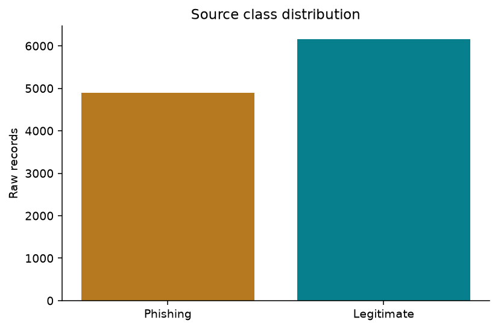
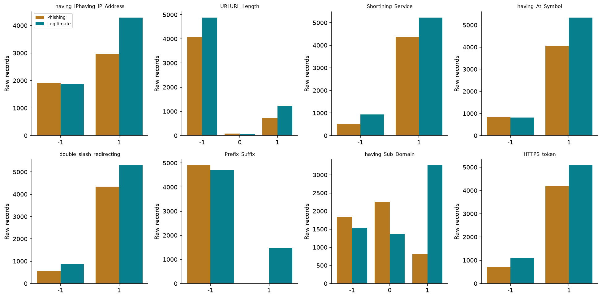
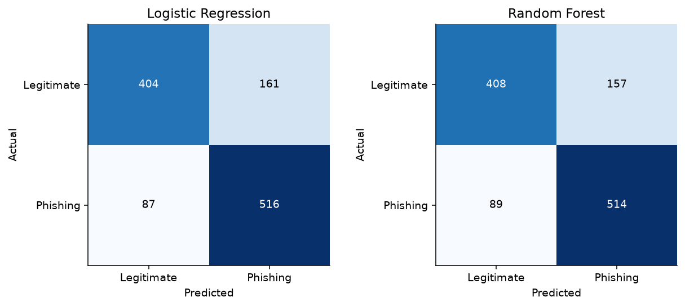
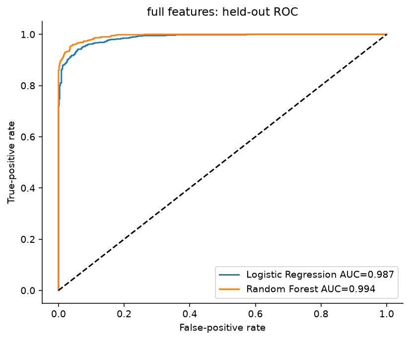
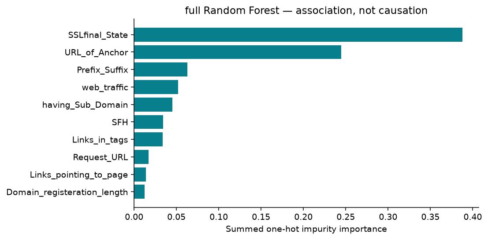

# PhishGuard AI: Evaluating phishing detection from encoded website features

**Mawutorwu Klu · Research report draft · October 9, 2026**

Six-page presentation draft with figures; final page count depends on the document template. All reported experiment values below were measured locally. Final presentation delivery is not yet complete.

## 1. Introduction and research question

Phishing detection is a classification problem with unequal consequences. A false negative allows a phishing example to appear legitimate, potentially exposing users to credential theft. A false positive interrupts access to a legitimate service and can encourage users to ignore warnings. A useful evaluation must therefore report both types of error and explain the evidence a model actually receives.

The research question is: **How accurately can machine-learning models distinguish phishing websites from legitimate websites using URL-based features?** PhishGuard AI investigates this question within the existing K.E.A.N. cybersecurity workbench. It extends the portfolio with a reproducible experiment and an interactive presentation, rather than substituting a canned score for a trained model.

Dataset inspection revealed an important scope issue. The reference dataset contains address-related indicators but also page-content, certificate, registration and reputation features. A high score using all indicators cannot be described as performance from URL text alone. This study therefore reports two scopes separately: an eight-feature URL-focused experiment and a full 30-feature benchmark. Each scope compares Logistic Regression with Random Forest.

The dashboard connects dataset exploration, preprocessing decisions, evaluation and error inspection. It does not fetch submitted websites. This design makes the boundary between historical research and a live security product visible to the audience.

## 2. Dataset, provenance and exploration

The supplied Kaggle reference notebook is *Phishing URL EDA and modelling* by Akash Kumar. Its Input page directly links *Phishing website dataset*, owned by `akashkr`, version 2. That relationship was inspected before downloading `dataset.csv`; the source was not selected by matching a similar dataset name. The dataset card lists CC0 licensing. The CSV SHA-256 is recorded in `results/metrics.json` so future runs can verify the exact bytes.

The file contains **11,055 records and 32 columns**: one index, 30 predictors and `Result`. Source column documentation defines −1 as phishing, 0 as suspicious and +1 as legitimate. Inspection of the actual target found only −1 and +1: **4,898 phishing and 6,157 legitimate records**. The experiment maps phishing to the positive binary class, 1, and legitimate to 0. This internal mapping differs from the source coding and is explicit throughout evaluation.

No missing cells were observed. There are zero duplicate whole rows when the unique index is included, but **5,206 repeated rows after the index is excluded**. Treating the identifier as a predictor would both hide this redundancy and introduce an artificial feature. Removing duplicate feature-and-label records leaves **5,849 rows**. This changes the distribution being evaluated: results concern retained feature records, not the original prevalence-weighted sample.

The URL-focused set comprises IP-address usage, length category, shortening-service indicator, @ symbol, additional double slash, prefix/suffix indicator, subdomain category and HTTPS-token indicator. These are precomputed categories, not raw measurements or proven universal rules. For example, a hyphen is not itself evidence that a domain is malicious. The full set adds signals such as certificate state, page anchors, form destinations, domain age and historical traffic. The source descriptions are summarized in the feature dictionary.

Exploratory plots show raw category counts; the correlation heatmap uses deduplicated predictors. Pearson correlation on encoded categories is only a descriptive aid, since numeric spacing may not reflect a meaningful physical scale. No feature was selected by inspecting test-set performance.

## 3. Methodology and leakage prevention

The workflow first validates the expected schema, label values and encoded feature states. It removes the index and collapses exact feature-and-label duplicates. Identical predictors with contradictory targets remain in the data: deleting them by choosing a convenient label would hide uncertainty. Instead, predictor patterns are hashed into groups, separately for each feature scope, and each group is assigned entirely to train or test.

The first split from a shuffled five-fold `StratifiedGroupKFold`, with seed 42, serves as a single held-out experiment. **This is not five-fold cross-validation.** The URL-focused scope has 253 unique feature groups and uses 4,681 training records and 1,168 test records. The full scope has 5,785 unique groups, 4,679 training records and 1,170 test records. Both assert zero shared predictor-pattern groups between partitions. The test sets contain 603 and 604 phishing records respectively.

Grouping is valuable because a naive random row split could place repeated or indistinguishable feature patterns on both sides. However, identical-pattern grouping is not domain grouping. The CSV provides no domain identifiers or collection timestamps, so related sites and temporal relationships cannot be ruled out. Moreover, each feature scope produces a different grouping and test set; cross-scope score differences are descriptive rather than paired causal estimates of added features.

Both models use a pipeline that fits most-frequent imputation and one-hot categorical encoding only on training rows. No imputation is needed for the downloaded snapshot, but its placement preserves the correct behavior if missing entries are encountered in a compatible future file. One-hot categories avoid imposing a linear distance on −1, 0 and +1. They already share a 0/1 scale, so additional standard scaling is unnecessary for this representation. Unseen categories are handled without fitting on the test partition.

Logistic Regression uses C=1 and a 2,000-iteration limit. Random Forest uses 250 trees and a minimum leaf size of two. Random seeds are fixed. The planned class-weight rule enables balanced weights only when the training class ratio exceeds 1.5; it was not needed in either observed training set. No hyperparameter search or threshold tuning used held-out results. The default model decision rule is retained.

Saved pipeline artifacts include preprocessing and estimators. The JSON export records environment versions, seed, source IDs, metrics, ROC points, predictions and importance. The notebook reruns these same modules instead of maintaining a second implementation.

## 4. Results

All metrics treat phishing as positive. Accuracy summarizes correct predictions across both labels; precision measures how many phishing predictions are correct; recall measures how much phishing is caught; F1 combines precision and recall. ROC-AUC assesses ranking across thresholds rather than performance at one selected threshold.

| Scope | Model | Accuracy | Precision | Recall | F1 | ROC-AUC |
|---|---|---:|---:|---:|---:|---:|
| URL-focused | Logistic Regression | 78.77% | 76.22% | 85.57% | 80.63% | 0.8357 |
| URL-focused | Random Forest | 78.94% | 76.60% | 85.24% | 80.69% | 0.8423 |
| Full website | Logistic Regression | 93.68% | 95.07% | 92.55% | 93.79% | 0.9873 |
| Full website | Random Forest | 95.56% | 96.62% | 94.70% | 95.65% | 0.9939 |

The two URL-focused models perform similarly in this split. Random Forest has slightly higher accuracy, precision, F1 and ROC-AUC, while Logistic Regression has slightly higher recall. The differences are small and do not establish statistical superiority. The full-feature results are higher, but they include signals outside URL text and are evaluated on a separate group-aware split.

For URL-focused Logistic Regression, the confusion matrix is TN=404, FP=161, FN=87 and TP=516. URL-focused Random Forest gives TN=408, FP=157, FN=89 and TP=514. Thus, the forest reduces four false alarms but misses two more phishing records on the same URL-scope test set. That concrete trade-off is more useful than declaring a winner from rounded accuracy.

Full-feature Logistic Regression gives TN=537, FP=29, FN=45 and TP=559. Full-feature Random Forest gives TN=546, FP=20, FN=32 and TP=572. These are historical held-out record outcomes; they do not mean that only 32 phishing attacks would be missed in a real deployment with changing traffic and prevalence.

## 5. Discussion and cybersecurity interpretation

The URL-focused results suggest that the selected encoded address indicators carry useful information, but leave substantial ambiguity. The coarse representation compresses thousands of examples into only 253 distinct predictor patterns. Multiple websites can share a pattern while having different labels. A model cannot recover distinctions absent from its inputs. This limits claims that a lightweight address-only classifier provides comprehensive protection.

The full-feature benchmark uses richer observations and produces stronger measured scores. Its feature-importance chart aggregates Random Forest impurity importance across one-hot categories back to the original feature names. This explains which predictors contributed to this fitted forest’s splits. It does not establish that those features cause phishing or that manipulating a feature changes a real website’s safety. Correlated predictors may divide importance, and importance varies with modeling choices.

Operationally, missed phishing requires attention because an incorrect legitimate classification can encourage risky behavior. False positives also matter: interruptions, analyst review and warning fatigue impose costs. The dashboard therefore displays both confusion matrices and allows users to inspect records where at least one model is wrong. The test examples come from actual stored model predictions, not from handpicked invented confidence scores.

The free-text URL demo deliberately has a narrower function. It validates HTTP(S) syntax and displays lexical facts such as host, protocol, length and embedded credentials. It does not call a model, access DNS, visit the host, run submitted code, or render input as HTML. This separation avoids implying that the historical extraction pipeline has been recreated. Exact extraction rules, contemporaneous page data and external reputation observations would be required for equivalent live inference.

The research dashboard uses a Python-to-JSON export embedded in the standalone website. This supports offline presentation and avoids adding a prediction server or exposing API credentials. The existing K.E.A.N. command router can open the new section, while its existing providers and voice logic are left intact. The new research section is independent of the preserved academic coursework.

## 6. Limitations, conclusion and next steps

This is a reproducible initial experiment on a historical dataset, not a deployed detector. It uses one fixed split, so uncertainty across random partitions is unmeasured. Training-only cross-validation and a separately reserved final test set would be appropriate for future model selection. No statistical significance, confidence interval, probability calibration or production readiness is claimed.

Exact deduplication and grouping reduce a specific leakage risk but change sample weighting and cannot eliminate unknown domain or temporal relationships. The lack of raw URLs, timestamps and domain identifiers prevents a prospective evaluation. Several features reflect older web reputation systems or extraction conventions; these may no longer be available or meaningful in a modern deployment. Drift, adversarial adaptation and realistic class prevalence remain untested.

The original question is answered narrowly: in the measured URL-focused holdout, Logistic Regression achieved 78.77% accuracy and Random Forest 78.94%, with phishing recall of 85.57% and 85.24%. These models detect a substantial share of phishing feature records but also make consequential errors. The higher full-feature benchmark must not be substituted for the URL-focused answer.

Next steps are to rehearse the presentation, review false negatives, and propose a new dataset with raw URLs and trustworthy collection metadata. A future live system would require a validated feature extractor, controlled resource access, time/domain-disjoint evaluation, monitoring, calibrated decisions and a clear policy for uncertain cases. The present project deliberately stops at transparent research and safe local demonstration.

## References

1. Akash Kumar. *Phishing website dataset*, version 2. Kaggle. [Dataset and feature documentation](https://www.kaggle.com/datasets/akashkr/phishing-website-dataset). Accessed October 9, 2026.
2. Akash Kumar. *Phishing URL EDA and modelling*. [Reference notebook Input page](https://www.kaggle.com/code/akashkr/phishing-url-eda-and-modelling/input). Used to establish dataset provenance; implementation written independently.
3. scikit-learn developers. [Common pitfalls and recommended practices](https://scikit-learn.org/stable/common_pitfalls.html). Training-only preprocessing and leakage guidance.
4. scikit-learn developers. [StratifiedGroupKFold](https://scikit-learn.org/stable/modules/generated/sklearn.model_selection.StratifiedGroupKFold.html). Group-preserving approximate stratification.

**Reproduction record:** see `results/metrics.json`, `requirements.txt`, `src/` and the executed notebook. Final oral presentation is Planned; the experiment, dashboard and drafts are completed artifacts.
